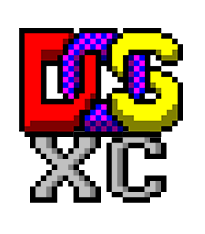
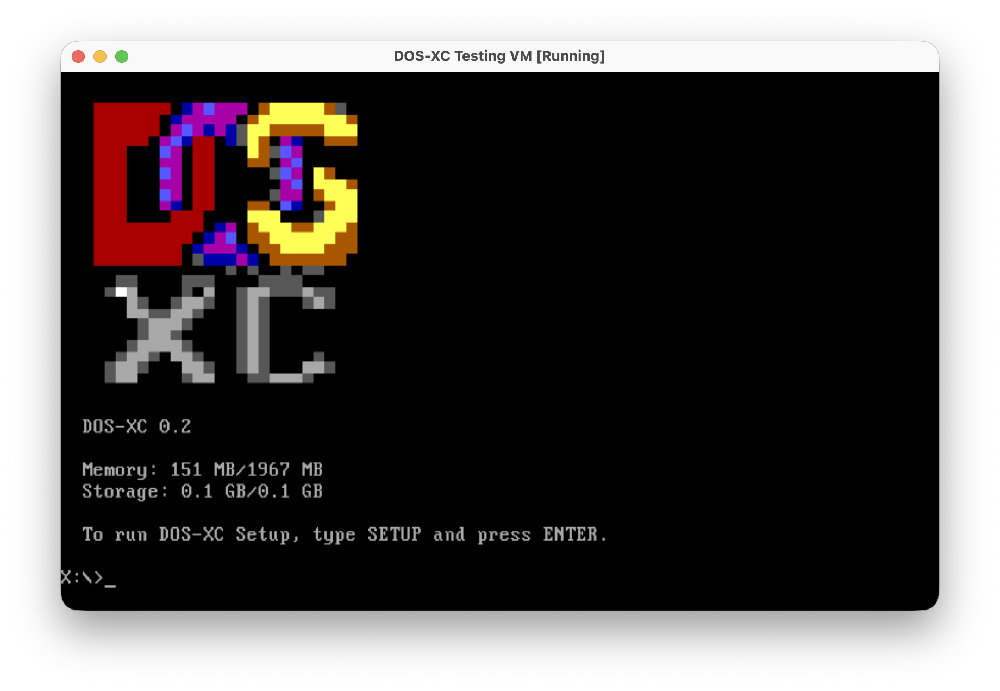
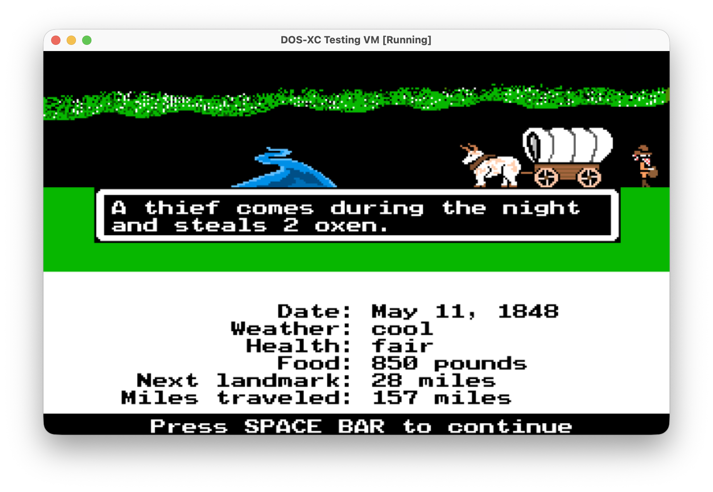
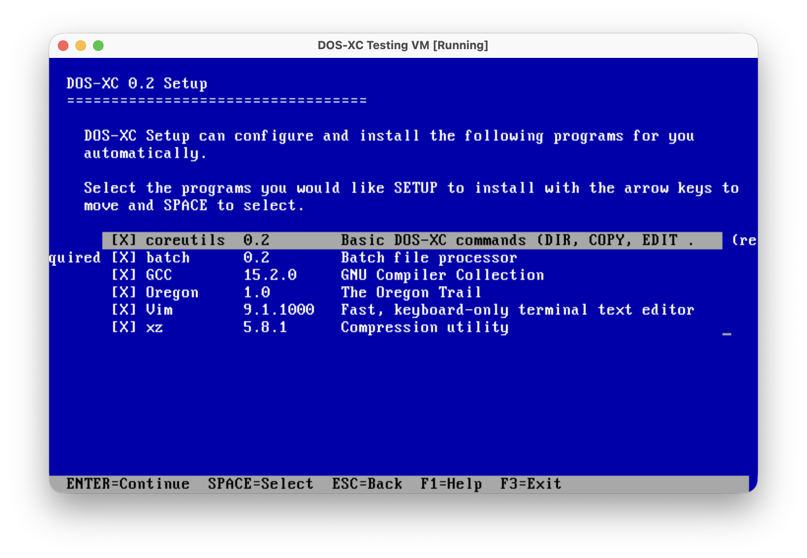
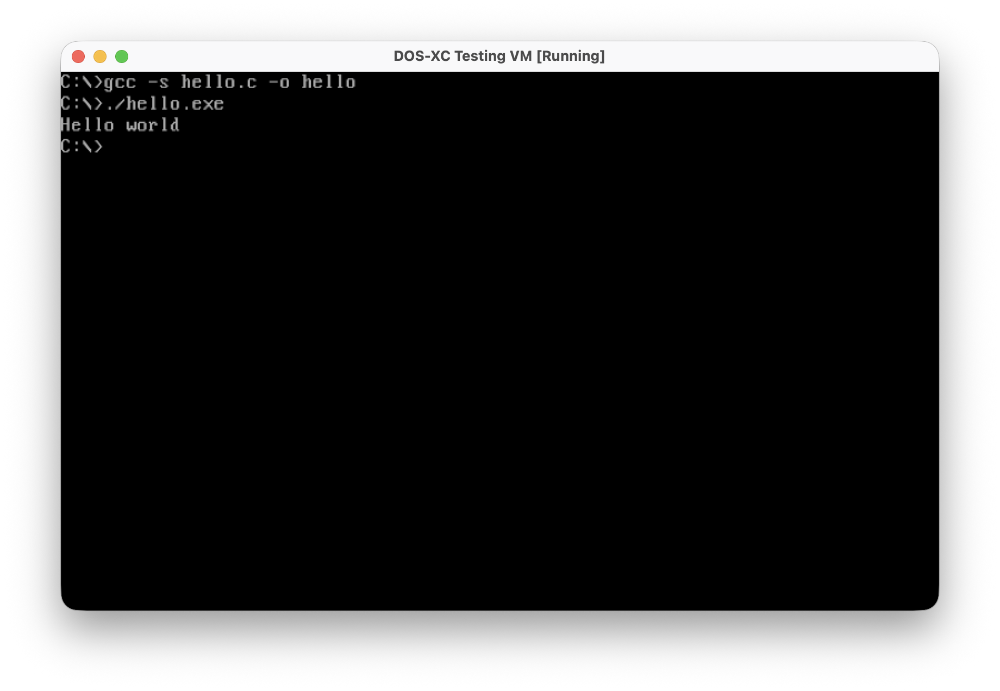

<h1 align="center" style="display:grid;place-items:center;">
    
    DOS-XC
</h1>

DOS-XC (DOS eXtended Core) is a full-fledged modern DOS operating system. It can run your 16-bit DOS programs, or new modern 32-bit and 64-bit programs. In summary, it's like DOS but awesome.

## Screenshots





## Goals
DOS-XC wants to be a(n):
- viable-to-use operating system you can actually use, work, and play on with proper 32-bit and 64-bit support
- easy-to-use operating system that people from your dad to your kids can use
- fun-to-use operating system that you can run your favorite DOS games with

## Get the system
Every version has an accompanying GitHub release, so you can start there: https://github.com/bendaws/dos-xc/releases/latest

- Download `DOSXC_<version>_x64.iso` for 64-bit systems, or `DOSXC_<version>_x86.iso` for 32-bit systems.

## Using the system
The installation media start a live system on drive `X:`; type `SETUP` to
install DOS-XC on a hard disk (it becomes `C:`).  Programs live in
`\Programs`, one folder per package, your files belong in `\Home`, and
`PKG` installs, updates and removes packages (`PKG HELP`).  Type `HELP`
for the commands; `D:` switches to another drive.  USB keyboards, mice and
drives can be plugged in and out at any time; `EJECT E:` before pulling
out a drive you wrote to.  `SHUTDOWN` switches the computer off (so does
its power button) and `RESTART` restarts it.

## Building
```sh
toolchain/build-toolchain.sh x86_64   # optional: GCC for the x64 edition (the GCC package)
toolchain/build-toolchain.sh i686     # optional: GCC for the x86 edition
ports/build-ports.sh x86_64           # optional: Vim and XZ (also for i686)
scripts/build.sh                      # build/iso/DOSXC_<version>_x86.iso and _x64.iso
scripts/boot64.sh                     # run in QEMU (MEMORY=1024 MiB by default); boot32.sh for x86
```

`scripts/build.sh` needs the cross compilers from `toolchain/cross` (the
shell, the commands, PKG and Setup are DOS-XC programs) and puts
intermediate files in `build/part`, packages in `build/packages` and the
bootable ISOs in `build/iso`.  Set `BUILD` to use another directory.
Put `OREGON.ZIP` in the repository root to build the Oregon Trail package.

## Documentation
- [docs/PROGRAMS.md](docs/PROGRAMS.md): the 32/64-bit program format, system calls, drives, the console, shared libraries and the C library
- [docs/PACKAGES.md](docs/PACKAGES.md): packages, PKG and the `.dsp` format
- [docs/TOOLCHAIN.md](docs/TOOLCHAIN.md): using and building GCC on DOS-XC, and the ports
- [docs/USB.md](docs/USB.md): USB keyboards, mice and drives
- [docs/NETWORK.md](docs/NETWORK.md): Ethernet, IPCONFIG, PING and sockets
- [docs/DRIVERS.md](docs/DRIVERS.md): writing and packaging device drivers
