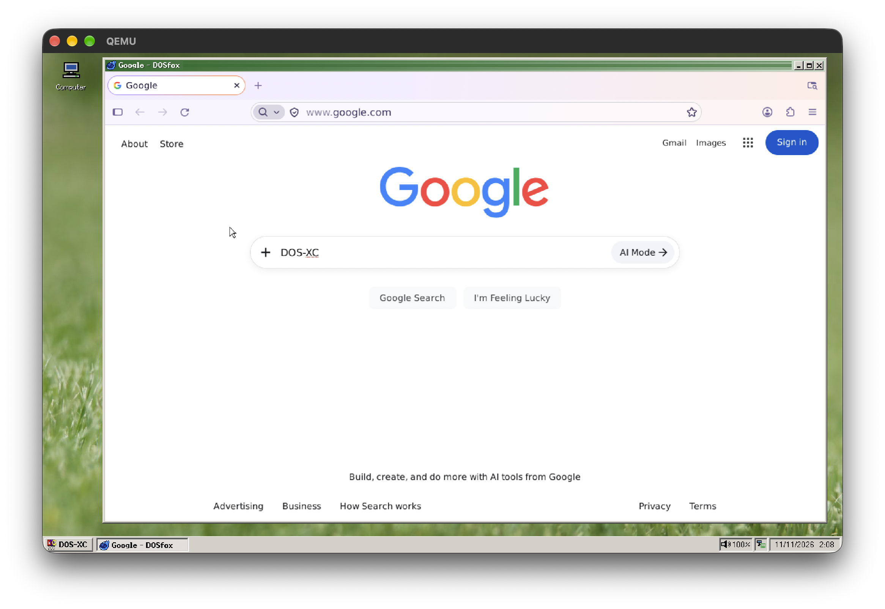
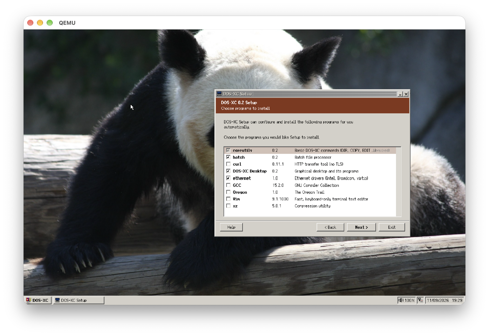
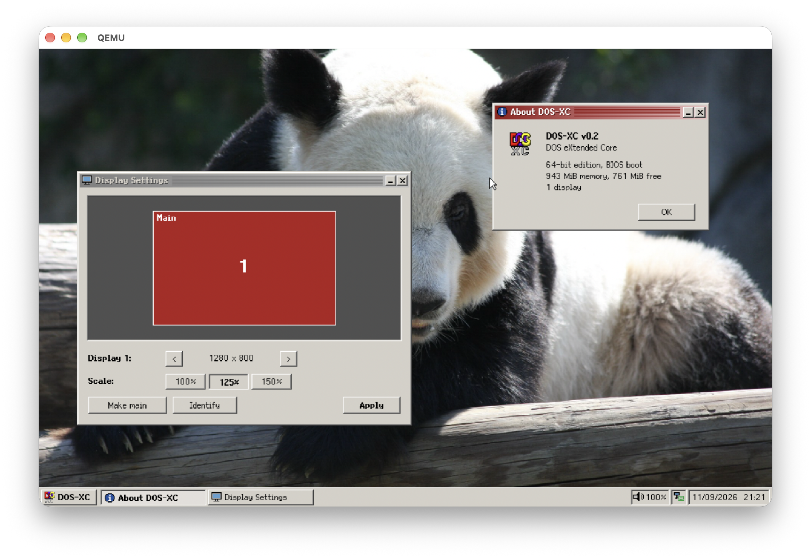

<h1 align="center" style="display:grid;place-items:center;">
    <br>
    DOS-XC
</h1>

DOS-XC (DOS eXtended Core) is a full-fledged modern DOS operating system. It can run your 16-bit DOS programs through kernel-level emulation, or new modern 32-bit and 64-bit programs. In summary, it's like DOS but awesome.

> [!WARNING]
> I know, DOS-XC is awesome and you would love to use it over your currently rock-solid stable operating system, but DOS-XC is beta software and should not be used as a daily machine unless you **llloovveee** DOS.
>
> We look forward to reaching our 500,000 user milestone by year 3000, when everything dies and all we have left is an early 2000s IBM machine.

## Screenshots







## Goals
DOS-XC wants to be a(n):
- viable-to-use operating system you can actually use, work, and play on with proper 32-bit and 64-bit support
- easy-to-use operating system that people from your dad to your kids can use
- fun-to-use operating system that you can run your favorite DOS games with

## Get the system
Every version has an accompanying GitHub release, so you can start there: https://github.com/bendaws/dos-xc/releases/latest

- Download `DOSXC_<version>_x64.iso` for 64-bit systems, or `DOSXC_<version>_x86.iso` for 32-bit systems.

## Using the system
By default, DOS-XC starts with its graphical environment, the DOS-XC Desktop. Here, you get graphical tools, games, and configuration utilities, plus wallpapers and greater customizability.

For hardcore DOS command line fans, you can uninstall the desktop by running the following, or by simply opting to not include the `desktop` package during setup:
```bat
pkg.exe remove "DOS-XC Desktop"
```

Your 16-bit MS-DOS programs run in a emulator and you can run them just like regular programs. On the DOS command line without a desktop, they are just ran like regular programs. We support MS-DOS programs up to MS-DOS 6.22.

## Building
```sh
# Builds GCC and ported programs
gcc/build.sh x86_64
gcc/build.sh i686
scripts/build-ports.sh x86_64

# Builds the ISOs to /build/iso/
scripts/build.sh

# Faster: choose the packages and editions on a checklist (--last repeats the choice)
scripts/build.sh --select
scripts/build.sh --only desktop,hyperv --editions 64

# Boots the ISO with QEMU, sub "64" for "32" to run the 32-bit system instead
scripts/boot64.sh

# Attach a virtual hard disk
scripts/boot64.sh -hd disk.img
```

## Repo layout
| Folder | Contents |
|--------|----------|
| [`os`](os) | Boot loader (bios/uefi), kernel, runtime, clib, shell, "pkg" utility, CLI setup |
| [`coreutils`](coreutils) | Basic commands (DIR, DEL, COPY, IPCONFIG) |
| [`batch`](batch) | Batch file processor |
| [`desktop`](desktop) | DOS-XC desktop + 16-bit emulator for DOS Prompt application |
| [`ethernet`](ethernet) | Ethernet drivers |
| [`sound`](sound) | Sound drivers package |
| [`hyperv`](hyperv) | Hyper-V emulator drivers |
| [`gcc`](gcc) | GCC and binutils build scripts |
| [`python`](python), [`curl`](curl), [`vim`](vim), [`xz`](xz) | Build scripts for ported programs |
| [`firefox`](firefox) | DOSfox package build kit (Firefox for DOS-XC) |
| [`oregon`](oregon) | The Oregon Trail package build kit |
| [`scripts`](scripts), [`tools`](tools), [`tests`](tests), [`docs`](docs) | Scripts/testing/tools |